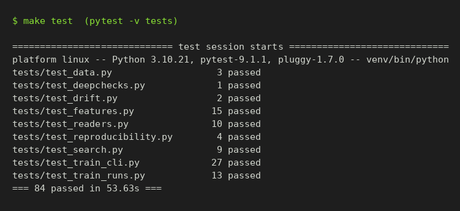
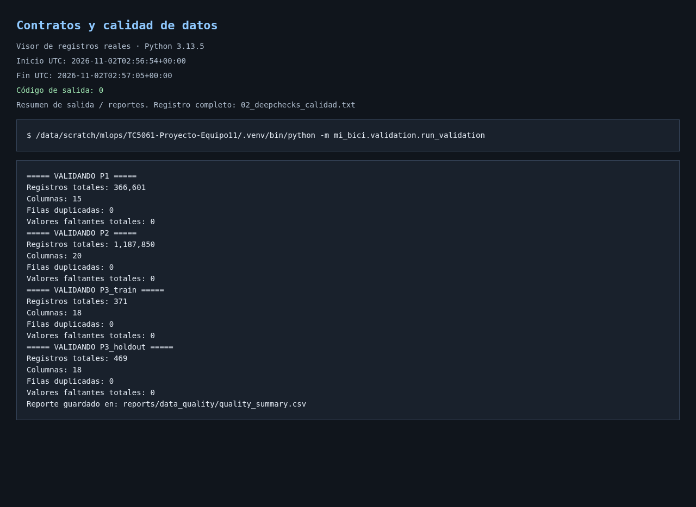
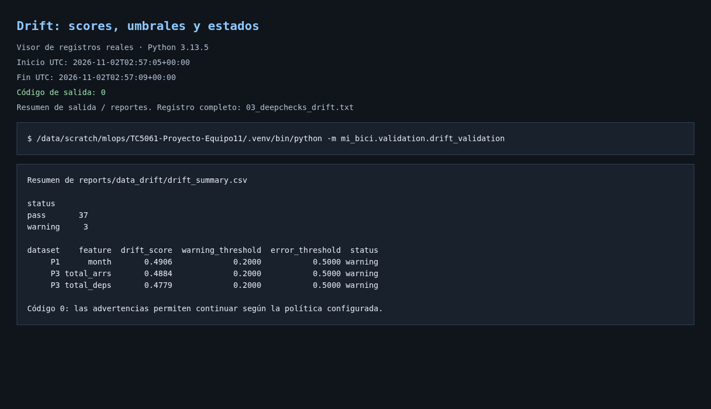
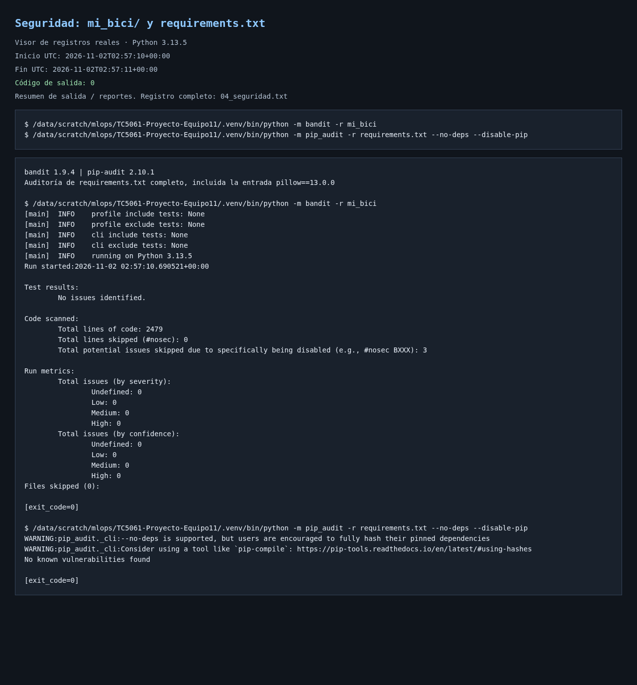
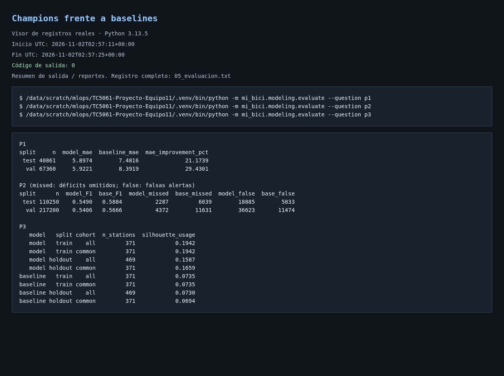
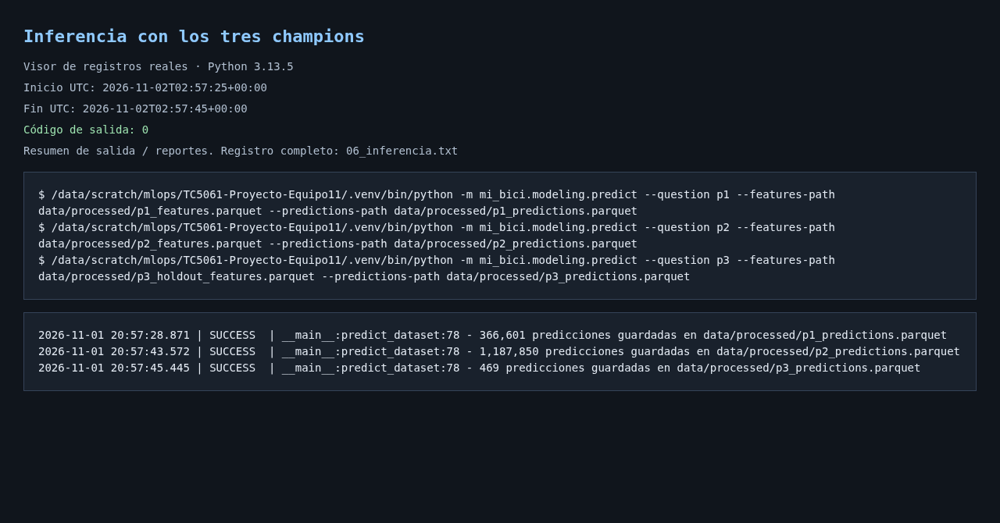

# Proyecto Integrador MLOps — MiBici (Equipo 11)

<a target="_blank" href="https://cookiecutter-data-science.drivendata.org/">
    
</a>

Propuesta técnica, pipeline reproducible de ingesta y preprocesamiento, módulo de ingeniería de características y experimento base en **MLflow Tracking** para el sistema de bicicleta pública **MiBici** del Área Metropolitana de Guadalajara (AMG).

---

## 1. Propósito del Proyecto y Preguntas de Negocio

El objetivo del proyecto es diseñar y construir una plataforma MLOps reproducible sobre millones de registros históricos de viajes de MiBici para apoyar la toma de decisiones operativas y de planeación urbana mediante tres tareas complementarias de Machine Learning:

| # | Pregunta de negocio | Tipo de tarea | Granularidad y Horizonte | Usuario y Decisión |
|---|---|---|---|---|
| **P1** | ¿Cuántos viajes se iniciarán en una estación o zona en un periodo futuro? | **Regresión** | Diaria por estación (`station_id`, `date`), horizonte de **1 día** (24 h). | **Operador del sistema:** Planear la dotación diaria de bicicletas y el mantenimiento de flota. |
| **P2** | ¿Una estación estará en riesgo de quedarse sin bicicletas o sin anclajes disponibles en un periodo futuro? | **Clasificación multiclase** | Horaria por estación (`station_id`, `hour_ts`), horizonte de **3 horas** (`deficit`, `balanceado`, `excedente`). | **Equipo de rebalanceo:** Priorizar cada hora las rutas de camiones hacia estaciones con mayor riesgo. |
| **P3** | ¿Qué grupos de estaciones comparten patrones de uso y dónde se ubican en la ciudad? | **Clustering** | Por estación activa (`station_id`), recalibración trimestral ($k=4$). | **Planeación urbana:** Decidir la expansión de estaciones y ampliación de capacidad (`dpcapacity`). |

El detalle completo de la formulación se encuentra en [`references/ml-canvas.md`](references/ml-canvas.md) y la arquitectura del sistema en [`references/architecture/architecture.md`](references/architecture/architecture.md).

---

## 2. Datos Utilizados, Privacidad y Partición Temporal

- **Fuente oficial:** [Portal de Datos Abiertos de MiBici](https://mibici.net/es/datos-abiertos/) (URLs declaradas en [`config/sources.yaml`](config/sources.yaml)).
- **Rango seleccionado:** `2024-01` a `2026-09` (**33 meses** completos de operación más el catálogo de estaciones `nomenclatura_2026_09.csv` con **484 estaciones**, de las cuales 470 están activas y 14 tienen prefijo `ex-`).
- **Justificación del rango:** Cubre dos ciclos anuales completos (2024 y 2025) para capturar la estacionalidad climática (temporada de lluvias en verano) y académica del AMG en entrenamiento, dejando 9 meses de 2026 para validación y prueba.
- **Protección de datos personales:** Las columnas `Usuario_Id`, `Genero` y `Año_de_nacimiento` se excluyen directamente durante la lectura del CSV en [`mi_bici/data/readers.py`](mi_bici/data/readers.py), por lo que nunca se almacenan en Parquet ni se registran en MLflow.
- **Partición temporal estricta (sin fuga del futuro):**
  - **Train:** `2024-01-01` a `2025-12-31` (24 meses)
  - **Validación:** `2026-01-01` a `2026-06-30` (6 meses)
  - **Test:** `2026-07-01` a `2026-09-30` (3 meses)

---

## 3. Estructura del Repositorio

```text
├── LICENSE                  <- Licencia del proyecto
├── Makefile                 <- Comandos de utilidad (make mlflow-server, make train-all, make test, make lint)
├── MLproject                <- Definición de entry points reproducibles para MLflow Projects
├── python_env.yaml          <- Entorno de Python que usa MLproject
├── README.md                <- Documentación principal del proyecto
├── pyproject.toml           <- Metadatos del paquete mi_bici y declaración de dependencias
├── requirements.txt         <- Dependencias del pipeline con versiones fijas
├── requirements-dev.txt     <- Dependencias de desarrollo (Jupyter, pytest, ruff) con versiones fijas
├── config/
│   ├── sources.yaml         <- Catálogo declarativo de URLs de viajes (2024-01 a 2026-09) y estaciones
│   └── data_manifest.json   <- Manifiesto versionado con hashes SHA-256 (hashlib) y conteos de filas
├── data/
│   ├── raw/                 <- CSVs originales descargados (excluidos de Git)
│   ├── interim/             <- Datos intermedios (excluidos de Git)
│   └── processed/           <- Archivos Parquet limpios y tablas de features (excluidos de Git)
├── models/                  <- Modelos serializados (excluidos de Git)
├── notebooks/
│   ├── 01-jcc-data-ingestion.ipynb                    <- Exploración de ingesta, encodings y esquemas
│   ├── 1.0-lact-descripcion.ipynb                     <- Exploración descriptiva de viajes y estaciones
│   └── pruebas/                                       <- Notebooks de experimentación y validación por caso
│       ├── 1.0-ogt-prueba-limpieza-y-parquet.ipynb    <- Prueba de limpieza, Parquet y manifiesto
│       ├── 2.0-ogt-prueba-p1-regresion.ipynb          <- Experimentación de P1 (Regresión diaria)
│       ├── 3.0-ogt-prueba-p2-clasificacion.ipynb      <- Experimentación de P2 (Clasificación horaria)
│       └── 4.0-ogt-prueba-p3-clustering.ipynb         <- Experimentación de P3 (Clustering de uso)
├── references/
│   ├── ml-canvas.md         <- Machine Learning Canvas completo para P1, P2 y P3
│   └── architecture/        <- Diagramas de arquitectura (Markdown/Mermaid, HTML interactivo y PNG)
├── reports/
│   ├── propuesta_equipo11.md <- Documento integrador de la propuesta y resultados con APA 7
│   └── figures/             <- Gráficas generadas y registradas como artefactos en MLflow
├── tests/
│   ├── test_data.py         <- Pruebas unitarias de validación de esquemas y fechas
│   └── test_train_cli.py    <- Pruebas de la CLI de hiperparámetros de train
└── mi_bici/                 <- Módulo principal de código fuente
    ├── __init__.py
    ├── config.py            <- Configuración centralizada (rutas, fechas, semilla=42, MLflow)
    ├── dataset.py           <- CLI de ingesta, escritura a Parquet y manifiesto SHA-256
    ├── features.py          <- Funciones documentadas de feature engineering para P1, P2 y P3
    ├── plots.py             <- Utilidades de visualización
    ├── data/
    │   ├── __init__.py
    │   ├── schemas.py       <- Contratos de columnas, variantes de headers y tipos
    │   ├── sources.py       <- Descarga HTTP con reintentos y soporte de archivos parciales (.part)
    │   └── readers.py       <- Detección de encoding, normalización de fechas y exclusión de PII
    └── modeling/
        ├── __init__.py
        ├── train.py         <- Ejecución y registro en MLflow de baselines y modelos candidatos
        ├── search.py        <- Búsqueda de hiperparámetros con nested runs
        ├── register.py      <- Selección del mejor candidato y alias champion en el Model Registry
        ├── evaluate.py      <- Evaluación del champion contra baselines y registro de reportes
        ├── evaluation.py    <- Métricas por clase, estación, periodo y cohortes de clustering
        └── predict.py       <- Inferencia con champion y salida CSV o Parquet
```

---

## 4. Requisitos e Instalación Reproducible

- Python 3.13
- [uv](https://docs.astral.sh/uv/) para la gestión reproducible del entorno virtual

Desde un clon limpio del repositorio:

```bash
uv venv --python 3.13 --seed .venv
source .venv/bin/activate
uv pip sync requirements-dev.txt
uv pip install -r requirements-test.txt
pip install -e . --no-deps
nbstripout --install --attributes .gitattributes
```

`make` es opcional, todos los comandos del README tienen su equivalente directo.

---

## 5. Ejecución con MLflow Projects

Todas las corridas se lanzan con `mlflow run` desde la raíz del repositorio. El archivo [`MLproject`](MLproject) define los entry points `ingest`, `features`, `train` y `main` (ingesta + features); fechas, rutas, semillas e hiperparámetros por default se leen de [`mi_bici/config.py`](mi_bici/config.py).

Con `--env-manager uv`, MLflow crea un entorno aislado a partir de [`python_env.yaml`](python_env.yaml) (las mismas versiones fijas de `requirements.txt`). Durante el desarrollo se puede usar `--env-manager local` para correr en el entorno activo.

### Paso 1: Levantar el servidor de tracking

El Model Registry requiere un backend con base de datos, por lo que se usa un servidor local de MLflow respaldado por SQLite. En una terminal aparte:

```bash
mlflow server --backend-store-uri sqlite:///mlflow.db --host 127.0.0.1 --port 5000
# o bien: make mlflow-server
```

La UI de MLflow queda en <http://127.0.0.1:5000>. `mlflow.db` y `mlartifacts/` están en `.gitignore`.

En la terminal donde se ejecutarán las corridas, apuntar MLflow al servidor (`mlflow run` no lee `config.py`; `make` exporta esta variable automáticamente):

```bash
export MLFLOW_TRACKING_URI=http://127.0.0.1:5000
```

### Paso 2: Ingesta reproducible, conversión a Parquet y versionado (`ingest`)
Descarga los 33 archivos mensuales y el catálogo de estaciones en `data/raw/`, normaliza columnas/codificación/fechas eliminando datos personales, guarda `data/processed/trips.parquet` y `data/processed/stations.parquet`, y actualiza `config/data_manifest.json` con el hash SHA-256 (`data_version`):

```bash
mlflow run . -e ingest --experiment-name mibici-equipo11 --env-manager uv
```

El rango por default (`START_MONTH`, `END_MONTH`) viene de `config.py`; se puede cambiar con `-P start=2024-01 -P end=2026-09`.

### Paso 3: Construcción de características sin fuga temporal (`features`)
Genera los conjuntos procesados `p1_features.parquet`, `p2_features.parquet`, `p3_train_features.parquet` y `p3_holdout_features.parquet` (perfil de 2026 para medir estabilidad):

```bash
mlflow run . -e features --experiment-name mibici-equipo11 --env-manager uv
```

Los pasos 2 y 3 también se ejecutan juntos con el entry point `main`: `mlflow run . --experiment-name mibici-equipo11 --env-manager uv`.

### Paso 4: Entrenamiento (`train`)
Cada `mlflow run -e train` entrena **un** modelo de una pregunta y genera **una** corrida en el experimento **`mibici-equipo11`** con parámetros (`question`, `model`, hiperparámetros, `start_month`, `end_month`, `data_version`, `random_seed`), etiquetas (`team`, `question`, `role`, `model_family`, `stage_of_work`, `git_commit`), métricas con prefijo (`val_*`, `test_*`) y gráficas como artefactos. MLflow agrega el commit, el entry point y el entorno de la corrida.

```bash
# P1: baseline y Ridge con alpha=0.5
mlflow run . -e train -P question=p1 -P model=baseline --experiment-name mibici-equipo11 --env-manager uv
mlflow run . -e train -P question=p1 -P model=ridge -P alpha=0.5 --experiment-name mibici-equipo11 --env-manager uv

# P2: HistGradientBoosting con max_depth=4
mlflow run . -e train -P question=p2 -P model=hgb -P max_depth=4 --experiment-name mibici-equipo11 --env-manager uv

# P3: K-Means de perfil de uso con 5 grupos
mlflow run . -e train -P question=p3 -P model=kmeans_usage -P n_clusters=5 --experiment-name mibici-equipo11 --env-manager uv
```

Los modelos disponibles y sus hiperparámetros por default están en `MODEL_DEFAULTS` de `config.py`. Para listarlos:

```bash
python -m mi_bici.modeling.train --list-models
```

Para entrenar todos los modelos con sus valores por default (un `mlflow run` por modelo):

```bash
make train-all
```

El `MLproject` solo declara `question` y `model`. Los hiperparámetros se agregan con `-P` (por ejemplo, `-P alpha=0.5`) y, si no se indican, se usa el valor de `config.py`. Así, cada corrida muestra solo los hiperparámetros de su modelo, con el valor que realmente usó, y los valores por default están en un solo lugar.

Si un hiperparámetro no corresponde al modelo, `train` lo rechaza e indica cuáles son válidos. Si se omite `--experiment-name`, `train` se detiene y explica cómo corregirlo.

### Paso 5: Búsqueda de hiperparámetros (`search`)
Cada búsqueda crea una corrida padre (`stage_of_work=search`) y una corrida hija por combinación del grid (`stage_of_work=candidate`), todas en `mibici-equipo11`. Los grids están en `SEARCH_GRIDS` de `config.py`. La métrica de comparación por pregunta está en `SELECTION_METRICS` y se calcula sobre validación. El padre guarda la mejor combinación en `best_hyperparameters.json`.

```bash
mlflow run . -e search -P question=p1 -P model=ridge --experiment-name mibici-equipo11 --env-manager uv
mlflow run . -e search -P question=p1 -P model=rf --experiment-name mibici-equipo11 --env-manager uv
mlflow run . -e search -P question=p2 -P model=hgb --experiment-name mibici-equipo11 --env-manager uv
mlflow run . -e search -P question=p3 -P model=kmeans_usage --experiment-name mibici-equipo11 --env-manager uv
```

### Paso 6: Artefactos de cada corrida
Todas las corridas guardan el manifiesto (`data/data_manifest.json`), la configuración (`config/`), el conjunto de entrenamiento como `mlflow.log_input` y las gráficas (`plots/`). Los candidatos guardan además el modelo con firma y ejemplo de entrada. No se registran datos personales: los viajes se limpian en la ingesta y las tablas de entrenamiento solo tienen estaciones y conteos.

### Paso 7: Model Registry (`register`)
`register` toma, por pregunta, las corridas candidatas ordenadas por su métrica de validación, registra la mejor como nueva versión del modelo y le asigna el alias `champion`; la segunda mejor queda como `challenger`. Cada versión lleva descripción y las etiquetas `git_commit`, `data_version`, `source_run_id` y `experiment`. Al terminar carga `models:/<nombre>@champion` para comprobar que funciona.

```bash
mlflow run . -e register -P question=p1 --experiment-name mibici-equipo11 --env-manager uv
mlflow run . -e register -P question=p2 --experiment-name mibici-equipo11 --env-manager uv
mlflow run . -e register -P question=p3 --experiment-name mibici-equipo11 --env-manager uv
```

| Pregunta | Modelo registrado |
|---|---|
| P1 | `mibici-equipo11-p1-demanda` |
| P2 | `mibici-equipo11-p2-riesgo` |
| P3 | `mibici-equipo11-p3-grupos` |

Para cargar el modelo en producción:

```python
import mlflow
mlflow.set_tracking_uri('http://127.0.0.1:5000')
model = mlflow.pyfunc.load_model('models:/mibici-equipo11-p1-demanda@champion')
```

**Esquema de ciclo de vida.** Se usan *aliases* y no las etapas (*Staging*, *Production*), que MLflow marcó como obsoletas desde la versión 2.9. Un alias es un puntero con nombre a una versión: el código siempre carga `@champion` y promover o revertir un modelo es mover el alias, sin cambiar código ni crear etapas fijas. Además se pueden tener varios alias a la vez (`champion` y `challenger`) y las etiquetas guardan el linaje de cada versión.

### Evaluación de calidad predictiva contra baselines

Después de registrar los modelos, `evaluate` fija la versión del alias `champion` y la compara con su baseline sobre las mismas observaciones. Se ejecuta con el servidor de tracking y `MLFLOW_TRACKING_URI` configurados como en los pasos anteriores:

```bash
python -m mi_bici.modeling.evaluate --question p1
python -m mi_bici.modeling.evaluate --question p2
python -m mi_bici.modeling.evaluate --question p3

# Equivalente con MLflow Projects
mlflow run . -e evaluate -P question=p1 \
  --experiment-name mibici-equipo11 --env-manager local
```

Los archivos de características deben cumplir sus contratos. P1 y P2 evalúan validación y test por separado y requieren ambos conjuntos; se excluyen las filas de entrenamiento. El champion permanece fijo y la evaluación no cambia hiperparámetros, el ranking ni el alias del modelo.

Los reportes CSV y `metadata.json` se guardan en `reports/evaluation/<question>/` (excluido de Git). La opción `--output-dir` permite cambiar el directorio base. Cada ejecución registra los reportes como artefactos `evaluation/` de MLflow, junto con métricas agregadas con prefijo `evaluation_`. Los metadatos identifican la versión concreta del modelo, la corrida de origen, la versión de datos y el baseline.

| Pregunta | Reportes y criterios de lectura |
|---|---|
| P1 | `summary.csv`, `by_station.csv`, `by_month.csv`: MAE, RMSE, WAPE y sesgo para modelo y Seasonal Naive (`lag_7d`), con cantidad de observaciones y diferencias contra el baseline |
| P2 | Los mismos segmentos, más `by_class.csv` y `confusion.csv`: precisión, recall, F1, soporte por clase, déficits no detectados y falsas alertas frente a la regla semanal (`risk_lag_168h`) |
| P3 | `summary.csv`, `by_cluster.csv`, `stations.csv`, `stability.csv`: silhouette, Davies–Bouldin, tamaños y perfiles de grupos, asignaciones por estación, cambios de uso y estabilidad temporal |

En P1, un `mae_improvement` positivo significa menor error que el baseline. `mae_improvement_pct` expresa la reducción relativa al MAE del baseline. Las predicciones negativas se limitan a cero para puntuar, igual que en entrenamiento; un sesgo positivo indica sobreestimación y uno negativo subestimación. WAPE queda vacío cuando la demanda real total del segmento es cero; la mejora porcentual de MAE queda vacía si el baseline tiene MAE cero.

En P2, `f1_macro_improvement` positivo significa mejor F1 que el baseline. El macro usa siempre las tres clases; las divisiones sin soporte se reportan como cero y deben leerse junto a `support` y `n_deficit`. `missed_deficits_reduction` positivo representa menos déficits omitidos; `false_deficit_alerts_reduction` negativo significa más falsas alertas. `extra_false_alerts_per_avoided_miss` cuantifica las falsas alertas adicionales por observación de déficit adicional detectada, y queda vacío si no se reducen las omisiones. Los conteos corresponden a observaciones estación-hora con horizonte de tres horas, no a incidentes independientes.

Los reportes por estación se ordenan por el deterioro respecto al baseline, primero los segmentos con peor diferencia. Conviene revisar el soporte de cada estación y los resultados mensuales antes de interpretar una mejora agregada.

Para P3, el baseline geográfico se ajusta únicamente con train y usa el número de grupos de `MODEL_DEFAULTS['p3']['baseline']`. Ambos modelos se comparan en el mismo espacio de uso, estandarizado solo con train. `cohort=all` incluye todas las estaciones del periodo; `cohort=common` conserva los mismos IDs en train y holdout. Se reportan número de grupos, estaciones nuevas y tamaño del grupo más grande para contextualizar las métricas. Las métricas de separación indefinidas quedan vacías y se marcan como `undefined_cluster_count`.

`ari_fixed_model` compara las asignaciones del mismo champion entre periodos para estaciones comunes; difiere del `holdout_ari_stability` de entrenamiento, que reajusta el estimador de clustering. Los números de grupo solo tienen significado dentro de cada modelo. La estabilidad del baseline geográfico sería trivial si sus coordenadas no cambian, por lo que no se usa como evidencia de mejora temporal. Además, el holdout de P3 ya participa en el piso de estabilidad del registro: esta comparación es un diagnóstico temporal, no una estimación final independiente.

#### Ejemplo de interpretación de los resultados

Con la versión de datos `a6306ebfef13` y los champions HGB (P1), HGB balanceado (P2) y K-Means de seis grupos (P3), la ejecución local produjo:

| Métrica | Champion | Baseline |
|---|---:|---:|
| P1: MAE de test | 5.8974 | 7.4816 |
| P2: F1 macro de test | 0.5490 | 0.5884 |
| P2: recall de déficit en test | 0.7751 | 0.4062 |
| P2: déficits omitidos en test | 2,287 | 6,039 |
| P2: falsas alertas de déficit en test | 18,885 | 5,833 |
| P3: silhouette en holdout, estaciones comunes | 0.1659 | 0.0694 |

P1 reduce el MAE global de test 21.17%, aunque 7 de las 469 estaciones evaluadas empeoran; el mayor deterioro corresponde a la estación 51. P2 detecta más déficits a cambio de peor F1 macro y más falsas alertas: su utilidad depende del costo operativo de omitir un déficit frente a movilizar recursos innecesariamente. P3 mejora la separación frente al baseline geográfico de cuatro grupos, pero su silhouette sigue siendo modesto. Estos resultados no equivalen por sí solos a una aprobación de uso operativo.

### Inferencia con el modelo champion

Después de registrar los modelos, `predict` carga el alias `champion` de la pregunta indicada usando `MLFLOW_TRACKING_URI`. La entrada debe contener las características ya calculadas. Se aceptan archivos CSV y Parquet tanto de entrada como de salida:

```bash
python -m mi_bici.modeling.predict --question p1 \
  --features-path data/processed/p1_features.parquet \
  --predictions-path data/processed/p1_predictions.parquet
```

El comando verifica las columnas requeridas contra la firma del modelo y MLflow valida sus tipos. Predice todas las filas del archivo recibido y guarda las columnas originales, en el mismo orden de filas, más `prediction`: demanda para P1, clase de riesgo para P2 o grupo para P3. Si falta el modelo o alguna columna requerida, los tipos son incompatibles o la entrada está vacía, termina con error antes de escribir la salida. La ruta de salida debe ser distinta de la entrada y la entrada no debe contener una columna `prediction` previa.

También está disponible como entry point de MLflow Projects:

```bash
mlflow run . -e predict -P question=p2 \
  -P features_path=data/processed/p2_features.parquet \
  -P predictions_path=data/processed/p2_predictions.csv \
  --experiment-name mibici-equipo11 --env-manager local

python -m mi_bici.modeling.predict --question p3 \
  --features-path data/processed/p3_holdout_features.parquet \
  --predictions-path data/processed/p3_predictions.parquet
```

### API de predicción

La API sirve el modelo de P1. Para usarla, el servidor de tracking debe estar activo y el modelo debe estar registrado:

```bash
export MLFLOW_TRACKING_URI=http://127.0.0.1:5000
uvicorn mi_bici.api.main:app --host 127.0.0.1 --port 8000
```

La documentación esta en <http://127.0.0.1:8000/docs>.

Por defecto se carga el alias `champion`. Se puede elegir otro modelo con `MODEL_NAME`, `MODEL_ALIAS` o `MODEL_VERSION`; si `MODEL_VERSION` tiene valor, se ignora `MODEL_ALIAS`.

Los valores de las predicciones y la versión del modelo pueden cambiar según el registry de cada equipo.

#### Predecir una fila

```bash
curl -X POST http://127.0.0.1:8000/p1/predict \
  -H 'Content-Type: application/json' \
  -d '{
    "instances": [
      {
        "lag_1d": 12.0,
        "lag_7d": 11.0,
        "lag_14d": 3.0,
        "lag_21d": 4.0,
        "rolling_mean_7d": 11.857143,
        "capacity": 19,
        "day_of_week": 2,
        "month": 9,
        "is_weekend": 0,
        "is_holiday": 0,
        "zone": "ZPN"
      }
    ]
  }'
```

Respuesta (`200`):

```json
{
  "model_name": "mibici-equipo11-p1-demanda",
  "model_version": "1",
  "predictions": [10.707358365638806]
}
```

#### Predecir varias filas

Cada petición acepta de 1 a 500 filas. Las predicciones llegan en el mismo orden que las filas:

```bash
curl -X POST http://127.0.0.1:8000/p1/predict \
  -H 'Content-Type: application/json' \
  -d '{
    "instances": [
      {"lag_1d": 12.0, "lag_7d": 11.0, "lag_14d": 3.0, "lag_21d": 4.0, "rolling_mean_7d": 11.857143, "capacity": 19, "day_of_week": 2, "month": 9, "is_weekend": 0, "is_holiday": 0, "zone": "ZPN"},
      {"lag_1d": 40.0, "lag_7d": 35.0, "lag_14d": 38.0, "lag_21d": 33.0, "rolling_mean_7d": 36.5, "capacity": 25, "day_of_week": 5, "month": 3, "is_weekend": 1, "is_holiday": 0, "zone": "GDL"}
    ]
  }'
```

Respuesta (`200`):

```json
{
  "model_name": "mibici-equipo11-p1-demanda",
  "model_version": "1",
  "predictions": [10.707358365638806, 32.464989857292]
}
```

#### Hacer la petición con Python

```python
import requests

row = {
    'lag_1d': 12.0,
    'lag_7d': 11.0,
    'lag_14d': 3.0,
    'lag_21d': 4.0,
    'rolling_mean_7d': 11.857143,
    'capacity': 19,
    'day_of_week': 2,
    'month': 9,
    'is_weekend': 0,
    'is_holiday': 0,
    'zone': 'ZPN',
}

response = requests.post(
    'http://127.0.0.1:8000/p1/predict',
    json={'instances': [row]},
    timeout=30,
)
response.raise_for_status()
print(response.json()['predictions'])  # [10.707358365638806]
```

#### Campos de cada fila

| Campo | Tipo | Valores válidos | Significado |
|---|---|---|---|
| `lag_1d`, `lag_7d`, `lag_14d`, `lag_21d` | número | 0 o más | Viajes de la estación hace 1, 7, 14 y 21 días |
| `rolling_mean_7d` | número | 0 o más | Media de viajes de los 7 días previos |
| `capacity` | entero | 1 o más | Anclajes de la estación |
| `day_of_week` | entero | 0 a 6 | Día de la semana: 0 es lunes, 6 es domingo |
| `month` | entero | 1 a 12 | Mes del año |
| `is_weekend` | entero | 0 o 1 | 1 si `day_of_week` es 5 o 6; debe coincidir con ese campo |
| `is_holiday` | entero | 0 o 1 | 1 si el día es festivo en México |
| `zone` | texto | `GDL`, `ZPN`, `TLQ` | Zona de la estación |

Todos los campos son obligatorios y no se aceptan campos adicionales, como `station_id` o `date`.

#### Respuesta con datos inválidos

Si una fila no cumple estas reglas, la API responde `422` e indica la fila y el campo con error. Por ejemplo, con `"month": 13` en la primera fila:

```json
{
  "detail": [
    {
      "loc": ["body", "instances", 0, "month"],
      "msg": "Input should be less than or equal to 12",
      "type": "less_than_equal"
    }
  ]
}
```

### API en contenedor

La imagen se construye con el `Containerfile` (el `Dockerfile` existente sigue levantando el servidor de MLflow). El modelo champion de P1 se descarga del Model Registry antes de construir y se copia dentro de la imagen, así el contenedor no necesita el servidor de MLflow para arrancar. Si hay que cambiar de modelo, se vuelve a exportar y a construir la imagen.

Con Docker:

```bash
export MLFLOW_TRACKING_URI=http://127.0.0.1:5000
python scripts/export_model.py --question p1 --output models/p1_champion
docker build -f Containerfile -t mibici-api .
docker run --rm -p 8000:8000 mibici-api
```

Con Podman los comandos son los mismos, cambiando `docker` por `podman` (o `make api-build CONTAINER_ENGINE=podman`).

Prueba del servicio:

```bash
curl http://127.0.0.1:8000/health
curl http://127.0.0.1:8000/model-info
curl -X POST http://127.0.0.1:8000/p1/predict -H 'Content-Type: application/json' \
  -d '{"instances":[{"lag_1d":12.0,"lag_7d":11.0,"lag_14d":3.0,"lag_21d":4.0,"rolling_mean_7d":11.857143,"capacity":19,"day_of_week":2,"month":9,"is_weekend":0,"is_holiday":0,"zone":"ZPN"}]}'
```

```json
{"model_name":"mibici-equipo11-p1-demanda","model_version":"1","predictions":[10.182341634926482]}
```

Variables del contenedor:

| Variable | Valor por defecto | Uso |
|---|---|---|
| `MODEL_PATH` | `/app/models/p1_champion` | Carpeta del modelo dentro de la imagen |
| `MLFLOW_TRACKING_URI` | sin definir | Solo si se quita `MODEL_PATH`: la API carga `MODEL_NAME`@`MODEL_ALIAS` del registry (por ejemplo `http://host.docker.internal:5000`; en Podman, `host.containers.internal`) |

Captura de la API respondiendo desde el contenedor: `docs/evidencia/api/06_swagger_contenedor.png`; el resto de las capturas y registros están en la misma carpeta, y el reporte en `docs/TC5061_Reporte_Despliegue_Equipo11.pdf`. Comparación con ONNX Runtime: `docs/analisis_onnx.md`.

Estrategia de despliegue: inferencia en tiempo real. La demanda del día siguiente se consulta por estación y las filas ya vienen calculadas (rezagos y calendario), por lo que una respuesta síncrona por petición es suficiente; para recalcular todas las estaciones se envían hasta 500 filas por llamada. Se incrusta el modelo en la imagen para que la versión servida quede fija y la imagen funcione igual en cualquier máquina.

### Paso 8: Pruebas, validación de datos y seguridad

Entorno de pruebas (además de `requirements.txt`):

```bash
pip install -r requirements.txt -r requirements-test.txt
pip install -e . --no-deps
```

Las herramientas directas de pruebas y seguridad tienen versiones fijas en `requirements-test.txt`: pytest 9.1.1, DeepChecks 0.19.1, anywidget 0.11.0, Bandit 1.9.4 y pip-audit 2.10.1. Se usa setuptools 80.10.2, verificado con la dependencia `pkg_resources` de DeepChecks. El entorno completo de la ejecución de evidencia queda registrado en [`environment.txt`](docs/evidencia/environment.txt).

| Comando | Qué hace |
|---|---|
| `make test` | Corre todo `tests/` con pytest |
| `make validate` | Calidad (`run_validation`) y drift (`drift_validation`) con DeepChecks sobre `data/processed/`. Requiere haber corrido `features` |
| `make security` | `bandit` sobre `mi_bici/` y `pip-audit` sobre `requirements.txt` |
| `make check` | `test` y `security` |

Estructura de `tests/`:

| Archivo | Cubre |
|---|---|
| `test_data.py`, `test_readers.py` | Contratos de encabezados, encodings, fechas mixtas y erróneas, limpieza de viajes y exclusión de datos personales |
| `test_features.py` | Rezagos y medias exactos por estación, causalidad temporal P1/P2, selección de estaciones solo con train y perfiles P3 |
| `test_train_cli.py`, `test_train_runs.py`, `test_search.py` | Hiperparámetros, corridas de MLflow, búsqueda |
| `test_reproducibility.py` | Misma semilla, mismas predicciones (Ridge, RF, HGB, K-Means) |
| `test_predict.py` | Inferencia por CLI con champions en un registro temporal, CSV/Parquet, conservación de filas y errores de entrada |
| `test_evaluation.py`, `test_evaluate_cli.py` | Comparaciones exactas contra baselines, errores por clase, segmentos temporales, cohortes comunes y artefactos de evaluación en MLflow |
| `test_contracts.py`, `test_deepchecks.py`, `test_run_validation.py` | Contratos completos, rangos, tipos, claves únicas, condiciones de DeepChecks y archivos requeridos |
| `test_drift.py` | Drift entre train y test, muestreo reproducible, umbrales y bloqueo con reportes |

Las pruebas de características usan conteos variables y estaciones con patrones distintos. En P1 verifican valores exactos de los cuatro rezagos y la media móvil, días sin viajes, estaciones nuevas y el límite de 21 días de historial. Cambiar los viajes del día actual o posteriores debe conservar los predictores pasados. En P2 se comprueba que modificar viajes futuros cambie el objetivo de tres horas, pero conserve los predictores disponibles en el corte, y que la actividad de 2026 no altere la selección de estaciones basada en entrenamiento. Los perfiles P3 cubren duraciones límite, proporciones y estaciones sin llegadas.

Para ejecutar solo estas pruebas de características y lectura:

```bash
python -m pytest -q tests/test_features.py tests/test_readers.py tests/test_data.py
```

`run_validation` exige los cuatro archivos de características: P1, P2, P3 train y P3 holdout. Si falta alguno, termina con error antes de validar o generar el reporte, enumera las rutas faltantes e indica que se debe ejecutar la ingesta y la generación de características.

#### Contratos de calidad

Los contratos están declarados en [`mi_bici/validation/contracts.py`](mi_bici/validation/contracts.py). Se evalúan sobre **todas las filas**: columnas exactas (faltantes y adicionales son errores), tipos nativos o nullable de pandas, ausencia de nulos y valores numéricos finitos. Los tipos se comprueban sin convertir ni corregir los datos. Todos los conjuntos deben tener datos, IDs enteros positivos, capacidad entera positiva y textos no vacíos.

| Conjunto | Clave única | Restricciones adicionales |
|---|---|---|
| P1 | `station_id`, `date` | Conteos y rezagos no negativos; mes 1–12, día de semana 0–6, indicadores 0/1 |
| P2 | `station_id`, `hour_ts` | Llegadas y salidas no negativas; hora 0–23; clases `deficit`, `balanceado` o `excedente`; los flujos y presiones pueden ser negativos |
| P3 train/holdout | `station_id` | Latitud −90–90, longitud −180–180, proporciones 0–1, duración mediana 1–180 minutos; estaciones activas y sin prefijo `ex-` según sus indicadores booleanos |

Las fechas de P1 y P2 deben ser datetime sin zona horaria dentro de `START_MONTH`–`END_MONTH`; `split` admite `train`, `val` y `test`. Las claves duplicadas se rechazan aunque otras columnas sean distintas. Si el contrato pasa, se ejecutan condiciones de DeepChecks sobre una muestra reproducible de hasta 5,000 filas: cero tipos mezclados, cero tipos de valores nulos reconocidos por DeepChecks y cero duplicados. Una condición incumplida o un fallo del chequeo detiene la validación.

Los resultados quedan en `reports/data_quality/quality_summary.csv`, con estado `pass` o `error`, y los incumplimientos en `quality_errors.csv`. Los reportes se escriben antes de terminar con error por calidad.

#### Política de drift

[`DRIFT_THRESHOLDS` en `mi_bici/config.py`](mi_bici/config.py) define los umbrales por método. Son valores iniciales configurables: deben calibrarse con evidencia de validación y criterios operativos del proyecto.

| Método | Advertir y continuar | Detener el pipeline |
|---|---|---|
| Kolmogorov-Smirnov | `0.20 <= score < 0.50` | `score >= 0.50` |
| Cramer's V | `0.20 <= score < 0.50` | `score >= 0.50` |

Un score menor que 0.20 tiene estado `pass`; las advertencias tienen estado `warning` y los bloqueos `error`. Un score no finito o fuera de 0–1 también bloquea. La configuración exige `0 <= warning < error <= 1` y un método desconocido produce error. Cada fila de `reports/data_drift/drift_summary.csv` conserva el método, el score, ambos umbrales y el estado. El CSV consolidado y los reportes HTML se guardan antes de detener el comando por drift.

Con los datos actuales se emiten advertencias por P1 en `month` (0.49) y P3 en `total_arrs` y `total_deps` (0.48); P2 permanece por debajo del umbral de advertencia (máximo 0.06). Los reportes no se versionan.

Sin `make`, los mismos chequeos se ejecutan con:

```bash
python -m mi_bici.validation.run_validation
python -m mi_bici.validation.drift_validation
```

La configuración externa `MLFLOW_TRACKING_URI` se lee del entorno (ver `.env.example`); `.env`, `mlflow.db`, `mlartifacts/` y los datos están en `.gitignore`. La auditoría de seguridad cubre `mi_bici/` con Bandit y el archivo `requirements.txt` completo con pip-audit, **incluida Pillow**. En la ejecución registrada, ambas herramientas terminaron con código 0 y sin hallazgos o vulnerabilidades conocidas reportadas en ese alcance.

Sin `make`, la seguridad se comprueba con:

```bash
python -m bandit -r mi_bici
python -m pip_audit -r requirements.txt --no-deps --disable-pip
```

#### Evidencia reproducible

[`scripts/collect_evidence.py`](scripts/collect_evidence.py) ejecuta los comandos reales y guarda sus salidas completas, versiones, fechas UTC y códigos de salida. [`execution.json`](docs/evidencia/execution.json) registra el commit base, los cambios locales presentes al iniciar y los hashes SHA-256 de requisitos, registros y capturas. Las imágenes son capturas de un visor HTML de esos registros y de resúmenes calculados desde los reportes; los archivos `.txt` conservan la salida completa. La captura de drift muestra explícitamente las advertencias que permiten continuar.

Con el entorno de Python activo y los datos procesados disponibles:

```bash
# Pruebas, calidad, drift y seguridad; guarda registros y entorno.
python scripts/collect_evidence.py

# También genera capturas; requiere Chromium o Google Chrome disponible en PATH.
python scripts/collect_evidence.py --screenshots

# Incluye evaluación e inferencia; requiere el tracking configurado y los tres champions.
python scripts/collect_evidence.py --screenshots --include-models
```

Si un comando falla, se registra su código y el colector termina con error. Las capturas de fallos conservan la salida completa. Por defecto, los resultados se escriben en `docs/evidencia/`; `--output-dir` permite elegir otro directorio. Los datos crudos y procesados permanecen excluidos de Git.

La evidencia actual usa **Python 3.13.5**:

| Etapa | Resultado | Registro completo |
|---|---|---|
| PyTest | 224 pruebas aprobadas, 15 advertencias | [01_pytest.txt](docs/evidencia/01_pytest.txt) |
| Calidad | P1: 366,601 filas; P2: 1,187,850; P3: 371/469 estaciones; contratos aceptados | [02_deepchecks_calidad.txt](docs/evidencia/02_deepchecks_calidad.txt) |
| Drift | 37 características en `pass`, 3 en `warning`, ninguna en `error` | [03_deepchecks_drift.txt](docs/evidencia/03_deepchecks_drift.txt) |
| Seguridad | Bandit sin hallazgos y pip-audit sin vulnerabilidades conocidas reportadas | [04_seguridad.txt](docs/evidencia/04_seguridad.txt) |
| Evaluación | Comparaciones de P1, P2 y P3 contra baselines | [05_evaluacion.txt](docs/evidencia/05_evaluacion.txt) |
| Inferencia | 366,601 / 1,187,850 / 469 predicciones para P1 / P2 / P3 | [06_inferencia.txt](docs/evidencia/06_inferencia.txt) |

La ingesta completa descargó 1,070.1 MB de CSV de 33 meses. Durante la generación de características se observó más de 4 GiB de memoria en el grupo de procesos de prueba, que se ejecutó con un límite de 6 GiB. Estas mediciones describen la ejecución local y ayudan a dimensionar el entorno.








### Integración continua
El workflow [`pipeline.yml`](.github/workflows/pipeline.yml) tiene dos jobs. `calidad` corre las pruebas, `make security` y una búsqueda de credenciales. Si pasa, `pipeline` clona el repositorio en un runner limpio y ejecuta lo anterior sin pasos manuales: servidor de tracking, ingesta, características, validación de datos con DeepChecks, entrenamiento de todos los modelos, dos búsquedas, registro, evaluación contra baselines e inferencia con los tres modelos `champion`. Los reportes de validación y evaluación se suben como artefactos incluso si falla el paso correspondiente; un error de calidad o drift impide continuar con el entrenamiento. Corre en cada push y PR hacia `main`, cada lunes y de forma manual.

---

## 6. Buenas Prácticas Aplicadas

| Ámbito | Buenas prácticas implementadas | Dónde se verifica |
|---|---|---|
| **MLflow Tracking** | 1. Experimento único `mibici-equipo11` y una run por `mlflow run` con nombre descriptivo (`p1-baseline`, `p1-candidate-ridge`, `p2-baseline`, `p2-candidate-hgb`, `p3-baseline`, `p3-candidate-kmeans_usage`).<br>2. Parámetros de reproducción completos: rango de fechas, `data_version` (SHA-256 de los CSV crudos, en el manifiesto), `random_seed=42` e hiperparámetros.<br>3. Etiquetas (`tags`) con `team=equipo11`, `question=P1|P2|P3` y `git_commit`.<br>4. Métricas con prefijo del conjunto (`val_mae`, `test_mae`, `val_f1_macro`, `test_f1_macro`, `train_silhouette_usage`, `holdout_ari_stability`).<br>5. Sin credenciales ni datos personales registrados. | [`mi_bici/modeling/train.py`](mi_bici/modeling/train.py) e Interfaz de MLflow |
| **Estructura y Código** | 1. Notebooks usados únicamente para exploración y pruebas en `notebooks/` y `notebooks/pruebas/`; la lógica reproducible vive en el paquete `mi_bici/`.<br>2. Configuración centralizada en un único archivo (`mi_bici/config.py`) sin repetir rutas, fechas ni semillas.<br>3. Dependencias con versión fija en `requirements.txt` y `requirements-dev.txt`. | [`mi_bici/config.py`](mi_bici/config.py), [`requirements.txt`](requirements.txt) |
| **Datos y Git** | 1. `.gitignore` excluye `data/raw/`, `data/processed/`, `*.parquet`, `mlruns/`, `mlartifacts/`, `mlflow.db`, `models/` y `.env`.<br>2. Rama `main` protegida y flujo de trabajo mediante Pull Requests revisados por el equipo. | [`.gitignore`](.gitignore) e historial de PRs en GitHub |

---

## 7. Flujo de Trabajo y Contribución (Git & Pull Requests)

Para mantener la estabilidad del proyecto, la rama `main` está protegida. Todos los cambios se integran a través de un **Pull Request (PR)** revisado y aprobado por otro integrante del equipo siguiendo **GitHub Flow** y **Conventional Commits** (`feat:`, `fix:`, `docs:`, `chore:`, `refactor:`):

1. Actualizar rama local:
   ```bash
   git checkout main && git pull origin main
   ```
2. Crear una rama descriptiva (`feat/<nombre>`, `docs/<nombre>`, `chore/<nombre>`):
   ```bash
   git checkout -b feat/nombre-de-tu-tarea
   ```
3. Confirmar cambios atómicos y subir la rama:
   ```bash
   git add .
   git commit -m "feat: descripción breve del cambio"
   git push -u origin feat/nombre-de-tu-tarea
   ```
4. Abrir el Pull Request con GitHub CLI (`gh pr create`) o desde la interfaz web de GitHub y solicitar la revisión de al menos un compañero antes de hacer el merge.

---

## 8. Integrantes del Equipo 11 y Roles

| Integrante | Matrícula | Usuario GitHub | Rol principal |
|---|---|---|---|
| **Jimena María Suárez Muñoz** | `A01652504` | `@JimenaMaSuMu` | Configuración de seguridad y exclusión de artefactos (`.gitignore`), revisión de contratos de datos y validación de PRs. |
| **Jesús Carrillo Cantú** | `A01840421` | `@chuycc` | Diseño e implementación de ingesta reproducible (`sources.py`, `readers.py`, `schemas.py`, `dataset.py`), notebook de ingesta y formulación inicial de ML Canvas. |
| **Oscar Alfonso Valenzuela Muñoz** | `A01840486` | `@oscartrix` | Arquitectura MLOps, experimentación en notebooks de pruebas, módulo `features.py`, tracking en MLflow (`train.py`) y guía de flujo Git. |
| **Luis Antonio Cárdenas Trejo** | `A01840592` | `@luis-antonio-cardenas` | Diseño de arquitectura del sistema, notebook exploratorio (`1.0-lact-descripcion.ipynb`), diagramas estáticos/interactivos (`architecture.html`) y revisión de PRs. |
