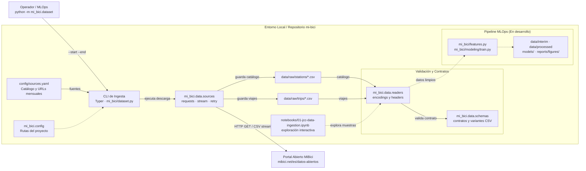

# Arquitectura del Pipeline de Datos (MiBici)

Este documento describe la arquitectura técnica del pipeline de datos del proyecto **MiBici MLOps**. Incluye tanto la especificación de componentes como el acceso al diagrama interactivo generado con **Archify**.

---

## Diagrama Interactivo (Archify)

El pipeline cuenta con un diagrama interactivo autónomo (HTML + SVG inline) que soporta zoom, navegación panorámica, conmutación de temas (claro/oscuro), trazado de rutas de dependencias, inspección de tarjetas de nodos y exportación en múltiples formatos (PNG, SVG, WebM).

👉 **[Abrir Diagrama de Arquitectura Interactivo](architecture.html)**

> **Nota para visualización local:**  
> Puedes abrir directamente [`architecture.html`](architecture.html) en tu navegador web favorito (Chrome, Safari, Edge, Firefox) o mediante una extensión como *Live Server* en VS Code. No requiere conexión a internet ni servidores externos.

### Vistas guiadas incluidas en el diagrama interactivo:
1. **Flujo de Ingesta:** Traza el camino desde el operador CLI y la configuración de fuentes (`config/sources.yaml`), pasando por el streaming HTTP desde el portal de MiBici, hasta el almacenamiento inmutable en `data/raw/`.
2. **Validación de Contratos:** Enfoca el módulo de lectores (`mi_bici.data.readers`) y contratos de esquemas (`mi_bici.data.schemas`), inspeccionando encodings y variantes de columnas en viajes y estaciones.
3. **Integración MLOps:** Muestra la relación con los notebooks exploratorios y los puntos de extensión hacia futuros módulos de ingeniería de características y modelado (`features.py`, `modeling/train.py`, `modeling/predict.py`).

---

## Vista Estática de Resumen

---

## Componentes y Límites del Sistema

1. **CLI de Ingesta (`mi_bici.dataset`):**
   - Valida el rango temporal (`--start` y `--end`) en formato `YYYY-MM`.
   - Controla la sobreescritura con el flag `--overwrite`.
   - Orquesta la descarga de catálogos y viajes, emitiendo métricas de volumen descargado (MB).
   - Ejecuta la validación de encabezados previa a cualquier consumo posterior.

2. **Fuentes de Datos (`mi_bici.data.sources`):**
   - Lee las URLs mensuales y la nomenclatura oficial desde `config/sources.yaml`.
   - Gestiona solicitudes HTTP con reintentos y persistencia en almacenamiento crudo (`data/raw/`).

3. **Lectura y Detección (`mi_bici.data.readers`):**
   - Detecta codificaciones de archivos heterogéneos (`detect_encoding`).
   - Compara y audita encabezados (`compare_headers`) de múltiples periodos.
   - Lee y transforma el catálogo de estaciones en DataFrames limpios (`read_stations`).

4. **Contratos de Datos (`mi_bici.data.schemas`):**
   - Aplica validación estricta de encabezados (`validate_header`) contra las variantes conocidas del servicio MiBici.
   - Asegura la consistencia estructural antes del paso a capas `interim` y `processed`.

5. **Entorno de Análisis y MLOps:**
   - **Notebooks (`notebooks/01-jcc-data-ingestion.ipynb`):** Exploración y verificación estadística de la ingesta.
   - **Módulos Downstream (`features.py`, `modeling/`):** Estructura preparada para extracción de características espacio-temporales y entrenamiento de modelos predictivos.

---

## Referencias de Implementación

- [Diagrama Interactivo Autónomo (HTML)](architecture.html)
- [Punto de entrada CLI (`mi_bici/dataset.py`)](../mi_bici/dataset.py)
- [Descarga y selección de fuentes (`mi_bici/data/sources.py`)](../mi_bici/data/sources.py)
- [Lectura y análisis de CSV (`mi_bici/data/readers.py`)](../mi_bici/data/readers.py)
- [Contratos y esquemas de datos (`mi_bici/data/schemas.py`)](../mi_bici/data/schemas.py)
- [Configuración de rutas del proyecto (`mi_bici/config.py`)](../mi_bici/config.py)
- [Catálogo de URLs de fuentes (`config/sources.yaml`)](../config/sources.yaml)
- [Notebook de ingesta y exploración](../notebooks/01-jcc-data-ingestion.ipynb)