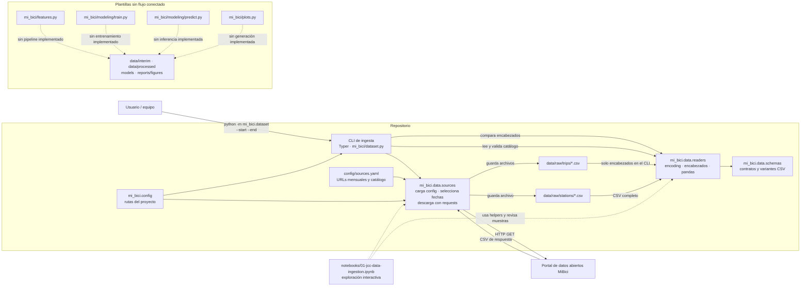

# Arquitectura actual

Este diagrama describe el flujo que está implementado en el repositorio. Distingue la ingesta ejecutable de los módulos de procesamiento y modelado que siguen siendo plantillas.

## Componentes y límites

- `mi_bici.dataset` valida el rango de meses, selecciona URLs, descarga los archivos, carga y valida el catálogo de estaciones y comprueba encabezados de viajes.
- `mi_bici.data.sources` obtiene las URLs de `config/sources.yaml` y guarda los CSV originales bajo `data/raw/`.
- `mi_bici.data.readers` detecta codificaciones y valida contratos definidos en `mi_bici.data.schemas`. El comando CLI revisa los encabezados de viajes, pero no carga ni transforma sus filas. `read_trips` existe como helper, pero no forma parte de ese comando.
- El notebook documenta exploración de los datos y reutiliza helpers del paquete; no es un servicio desplegado.
- `features.py`, `modeling/train.py`, `modeling/predict.py` y `plots.py` contienen código de plantilla. Las rutas de datos procesados, modelos y reportes están configuradas, pero el flujo actual no genera esos artefactos.

## Referencias de implementación

- [Comando de ingesta](../../mi_bici/dataset.py)
- [Descarga y selección de fuentes](../../mi_bici/data/sources.py)
- [Lectura y validación de CSV](../../mi_bici/data/readers.py)
- [Contratos de datos](../../mi_bici/data/schemas.py)
- [Rutas del proyecto](../../mi_bici/config.py)
- [Fuentes de datos](../../config/sources.yaml)
- [Notebook de exploración](../../notebooks/01-jcc-data-ingestion.ipynb)