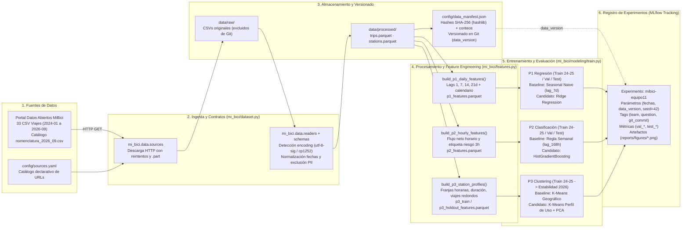

# Arquitectura del Sistema MLOps — Proyecto MiBici (Equipo 11)

Este documento presenta la arquitectura de extremo a extremo de la solución propuesta por el **Equipo 11** para responder las tres preguntas de negocio sobre el sistema **MiBici** (P1: Regresión de demanda diaria, P2: Clasificación horaria de riesgo de déficit/excedente, y P3: Clustering de estaciones por perfil de uso), así como la justificación técnica de cada herramienta con base en la bibliografía del curso.

**[Abrir Diagrama Interactivo Complementario (HTML)](architecture.html)**

---

## 1. Diagrama de Arquitectura del Sistema

---

## 2. Justificación de Herramientas por Componente

| Componente | Herramienta Elegida | Justificación técnica |
|---|---|---|
| **Estructura y Empaquetado** | **Cookiecutter Data Science (`ccds`) + `pyproject.toml` + `uv` + `MLproject`** | Siguiendo a **Wilson (2022, Cap. 6)** y **Lauchande (2021, Cap. 5)**, separar el código exploratorio (`notebooks/`) de los módulos reutilizables (`mi_bici/`) evita la fragilidad de ejecutar celdas manuales fuera de orden. El archivo `MLproject` y los puntos de entrada CLI con `Typer` permiten que cualquier integrante reproduzca el flujo con un solo comando. |
| **Ingesta y Contratos de Datos** | **Python (`requests`, `pandas`, esquemas declarativos en `schemas.py`)** | **Huyen (2022, Cap. 6)** destaca que los cambios silenciosos de esquema y codificación son una de las principales causas de fallas en pipelines de ML. Nuestro módulo `readers.py` detecta automáticamente `utf-8-sig` vs. `cp1252`, valida contratos de encabezados (`A}äe_nacimiento`), unifica formatos de fecha mixtos y elimina datos personales desde la entrada. |
| **Almacenamiento Analítico** | **Apache Parquet (`pyarrow`)** | Frente a ~1.07 GB de archivos CSV en texto plano, Parquet ofrece almacenamiento columnar comprimido y preserva los tipos exactos (`datetime64[ns]`, `Int32`, `float64`), acelerando más de 5 veces la lectura en las etapas de ingeniería de características y entrenamiento (**Huyen, 2022**). |
| **Versionado de Datos** | **Manifiesto JSON versionado en Git con `hashlib` (`sha256`)** | **Treveil et al. (2020)** enfatizan que la reproducibilidad en MLOps exige ligar cada modelo no solo con la versión del código (`git_commit`), sino también con la versión exacta de los datos (`data_version`). El manifiesto `config/data_manifest.json` registra el hash SHA-256 y conteo de filas de cada archivo (el `data_version` se deriva de los CSV crudos para no depender de la versión de `pyarrow`) sin subir datos pesados al repositorio Git. |
| **Procesamiento y Modelado** | **`pandas` + `scikit-learn` (`Pipeline`, `ColumnTransformer`)** | Encapsular el escalado (`StandardScaler`) y codificación (`OneHotEncoder`) dentro de `Pipeline` ajustado exclusivamente sobre el conjunto `Train` (`2024-01` a `2025-12`) previene la fuga de información futura (*data leakage*) hacia validación y prueba (**Huyen, 2022; Wilson, 2022**). |
| **Registro de Experimentos** | **MLflow Tracking (`sqlite:///mlflow.db`)** | Como exponen **Lauchande (2021)** y **Wilson (2022)**, comparar baselines contra modelos candidatos requiere un registro sistemático de parámetros, métricas prefijadas por partición (`val_mae`, `test_mae`), etiquetas de trazabilidad (`git_commit`, `question`, `team`) y artefactos visuales (matrices de confusión, series y mapas de clusters). |

---

## 3. Referencias de Implementación en el Repositorio

- [Configuración centralizada (`mi_bici/config.py`)](../../mi_bici/config.py)
- [CLI de ingesta, Parquet y manifiesto (`mi_bici/dataset.py`)](../../mi_bici/dataset.py)
- [Descarga y selección de fuentes (`mi_bici/data/sources.py`)](../../mi_bici/data/sources.py)
- [Lectura y validación de contratos CSV (`mi_bici/data/readers.py`)](../../mi_bici/data/readers.py)
- [Módulo de ingeniería de características (`mi_bici/features.py`)](../../mi_bici/features.py)
- [Entrenamiento y registro en MLflow (`mi_bici/modeling/train.py`)](../../mi_bici/modeling/train.py)
- [Diagrama interactivo de ingesta (`architecture.html`)](architecture.html)
