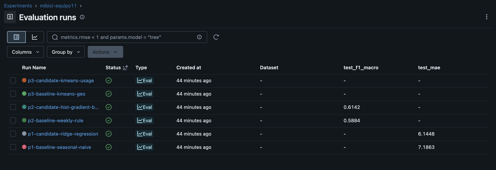
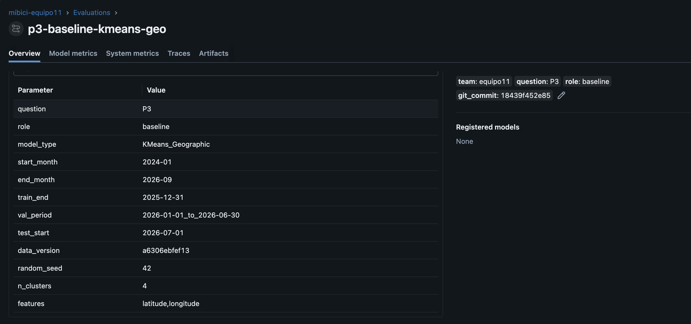
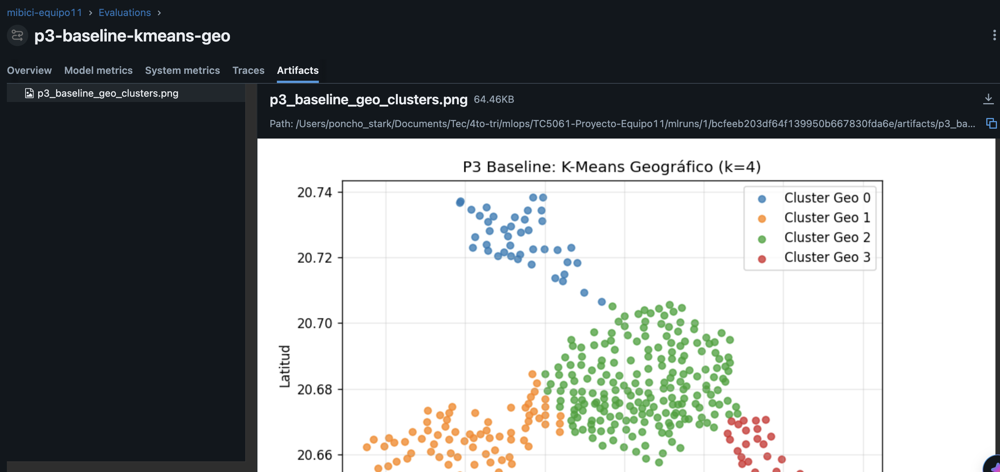
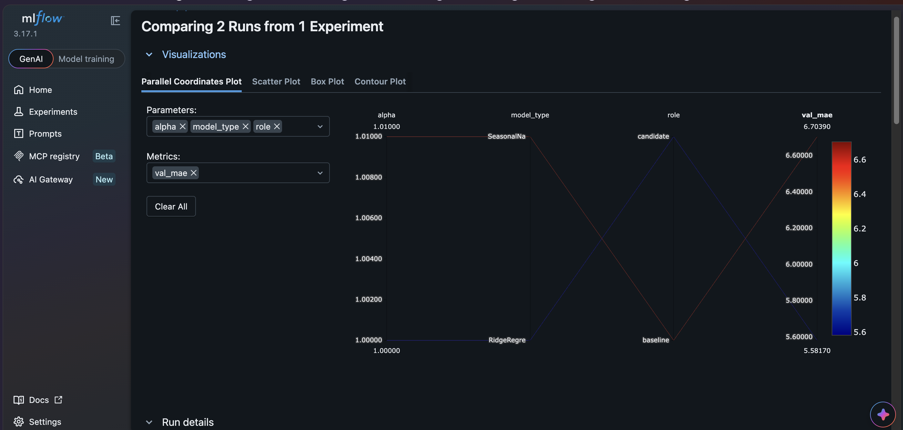
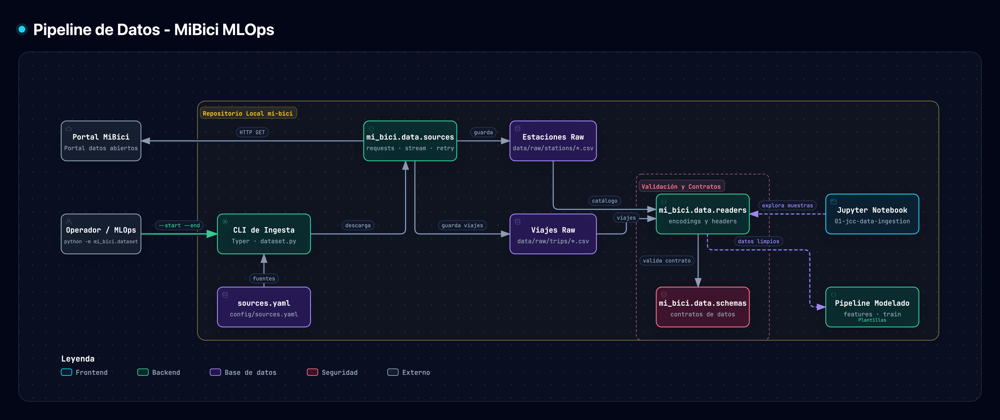

# TC5061 — Propuesta de Proyecto Integrador MLOps: Sistema MiBici (Equipo 11)

- **Repositorio de GitHub:** [https://github.com/oscartrix/TC5061-Proyecto-Equipo11](https://github.com/oscartrix/TC5061-Proyecto-Equipo11)
- **Experimento en MLflow:** `mibici-equipo11`
- **Integrantes (Equipo 11):**
  - **Jimena María Suárez Muñoz** — `A01652504` (`@JimenaMaSuMu`)
  - **Jesús Carrillo Cantú** — `A01840421` (`@chuycc`)
  - **Oscar Alfonso Valenzuela Muñoz** — `A01840486` (`@oscartrix`)
  - **Luis Antonio Cárdenas Trejo** — `A01840592` (`@luis-antonio-cardenas`)

---

## Parte A. Propuesta de Solución de Machine Learning

### 1. Formulación del Problema y Machine Learning Canvas

El sistema de bicicleta pública **MiBici** opera en el Área Metropolitana de Guadalajara (Guadalajara, Zapopan y Tlaquepaque). Su operación diaria enfrenta tres retos fundamentales: planear la dotación diaria de bicicletas por estación, anticipar desbalances horarios antes de que una estación quede vacía o saturada, y comprender los patrones de uso para orientar la expansión de la red.

| # | Pregunta de negocio | Tipo de tarea | Qué se predice o agrupa | Granularidad y Horizonte | Quién usa el resultado y qué decisión toma |
|---|---|---|---|---|---|
| **P1** | ¿Cuántos viajes se iniciarán en una estación o zona en un periodo futuro? | **Regresión** | Cantidad de viajes diarios iniciados (`trips_count` $\ge 0$). | Por estación y día (`station_id`, `date`), horizonte de **1 día** (siguientes 24 h). | **Operador del sistema:** Asignar el inventario inicial diario por estación y programar mantenimientos preventivos de flota. |
| **P2** | ¿Una estación estará en riesgo de quedarse sin bicicletas o sin anclajes disponibles en un periodo futuro? | **Clasificación multiclase** | Estado de riesgo operativo `{deficit, balanceado, excedente}`. | Por estación y hora (`station_id`, `hour_ts`), horizonte de **3 horas** futuras acumuladas. | **Equipo de rebalanceo:** Priorizar cada hora las rutas de camionetas para abastecer estaciones en `deficit` y liberar anclajes en `excedente`. |
| **P3** | ¿Qué grupos de estaciones comparten patrones de uso y dónde se ubican en la ciudad? | **Clustering** | Segmento funcional de cada estación ($k=4$ grupos). | Por estación activa (`station_id`), recalibración trimestral. | **Planeación urbana:** Decidir dónde instalar nuevas estaciones o ampliar capacidad (`dpcapacity`) según la vocación del corredor. |

#### Justificación de la aproximación del riesgo en P2
Dado que el portal de datos abiertos de MiBici no publica el inventario minuto a minuto de bicicletas disponibles en cada estación, aproximamos la presión operativa en las próximas 3 horas mediante la razón entre el **flujo neto futuro acumulado de 3 horas** ($\text{llegadas}_{t+1..t+3} - \text{salidas}_{t+1..t+3}$) y la **capacidad física de la estación** (`capacity`):
$$\text{pressure\_ratio}_{s,t} = \frac{\sum_{h=1}^{3} (\text{arrivals}_{s, t+h} - \text{departures}_{s, t+h})}{\text{capacity}_s}$$
- **`deficit`** ($\text{pressure\_ratio}_{s,t} \le -0.30$): En las siguientes 3 horas saldrán en términos netos al menos el 30% de la capacidad total de la estación, poniéndola en alto riesgo de quedarse sin bicicletas (`11.13%` de los casos).
- **`excedente`** ($\text{pressure\_ratio}_{s,t} \ge +0.30$): En las siguientes 3 horas llegarán en términos netos al menos el 30% de la capacidad total de la estación, poniéndola en alto riesgo de quedarse sin anclajes disponibles (`11.92%` de los casos).
- **`balanceado`** ($-0.30 < \text{pressure\_ratio}_{s,t} < +0.30$): El flujo de entradas y salidas se compensa dentro de un margen manejable (`76.95%` de los casos).

El detalle completo del **Machine Learning Canvas** se encuentra en [`references/ml-canvas.md`](../references/ml-canvas.md).

---

### 2. Definición de los Datos, Privacidad y Partición Temporal

1. **Fuentes oficiales:**
   - Archivos mensuales de viajes (`datos_abiertos_AAAA_MM.csv`) publicados en [https://mibici.net/es/datos-abiertos/](https://mibici.net/es/datos-abiertos/) y listados en [`config/sources.yaml`](../config/sources.yaml).
   - Catálogo de estaciones [`nomenclatura_2026_09.csv`](https://mibici.net/site/assets/files/1118/nomenclatura_2026_09.csv).
2. **Rango de fechas elegido y justificación (`2024-01` a `2026-09`):**
   - Se seleccionaron **33 meses continuos** (`2024-01` a `2026-09`). Este rango captura dos ciclos anuales completos (`2024` y `2025`) para aprender la estacionalidad anual (temporada de lluvias en verano en Guadalajara, periodos vacacionales y ciclos escolares) sobre la red actual de estaciones, reservando los 9 meses de `2026` para validación y prueba.
3. **Tamaño real obtenido:**
   - **Meses descargados:** 33 archivos CSV (peso crudo total: **1,070.1 MB**, promedio de 32.4 MB por mes; 18 archivos en codificación `utf-8-sig` y 15 en `cp1252`).
   - **Viajes limpios consolidados:** **12,539,260 viajes** válidos almacenados en `data/processed/trips.parquet` (**236.25 MB**, versión de datos SHA-256: `a6306ebfef13`).
   - **Estaciones registradas:** **484 estaciones** en `data/processed/stations.parquet`, de las cuales **470 están activas** (`capacity > 0` y sin prefijo `ex-`) y **14 son estaciones retiradas** (`ex-`), distribuidas en tres zonas: `GDL` (357), `ZPN` (110) y `TLQ` (17).
4. **Variables originales y tratamiento de datos personales:**
   - **Viajes:** De las 8 columnas originales (`Viaje_Id`, `Usuario_Id`, `Genero`, `Año_de_nacimiento`, `Inicio_del_viaje`, `Fin_del_viaje`, `Origen_Id`, `Destino_Id`), se conservan únicamente las variables operativas (`trip_id`, `start_time`, `end_time`, `origin_id`, `destination_id`).
   - **Cumplimiento de privacidad:** Las columnas con información personal del usuario (`Usuario_Id`, `Genero`, `Año_de_nacimiento`) se descartan en la lectura inicial (`read_trips` en `mi_bici/data/readers.py`) y nunca se guardan en Parquet ni se registran en MLflow.
5. **Estrategia de partición temporal (sin fuga del futuro):**
   - **Train (`2024-01-01` a `2025-12-31`):** 24 meses para ajuste de transformadores (`StandardScaler`, `OneHotEncoder`) y entrenamiento.
   - **Validación (`2026-01-01` a `2026-06-30`):** 6 meses para ajuste y validación preliminar.
   - **Test (`2026-07-01` a `2026-09-30`):** 3 meses para evaluación final fuera de muestra.

---

### 3. Diseño del Pipeline de ML e Ingeniería de Características (`mi_bici/features.py`)

| Etapa | P1 (Regresión Diaria) | P2 (Clasificación Horaria) | P3 (Clustering de Estaciones) |
|---|---|---|---|
| **1. Limpieza y Agregación** | Conteo diario de viajes iniciados sobre la malla completa de las 470 estaciones activas (`462,010` registros estación-día). | Conteo horario de salidas (`departures`), llegadas (`arrivals`) y flujo neto (`arrivals - departures`) en las 50 estaciones activas de mayor flujo (`1,187,850` registros estación-hora). | Agregación por estación activa separando el periodo `Train` (2024–2025, `371` estaciones con viajes) del periodo `2026` (`469` estaciones). |
| **2. Feature Engineering (sin fuga temporal)** | `lag_1d`, `lag_7d`, `lag_14d`, `lag_21d`, `rolling_mean_7d` (sobre `shift(1)`), `day_of_week`, `month`, `is_weekend`, `is_holiday`, `capacity` y `zone`. | `hour`, `day_of_week`, `is_weekend`, `departures`, `arrivals`, `net_flow`, `pressure_last_3h` ($t-2..t$) y presión histórica en la misma ventana de 3h hace 24h (`pressure_window_lag_24h`), 7 días (`168h`) y 14 días (`336h`). | Proporción de salidas en mañana (`6-10h`), mediodía (`11-15h`), tarde (`16-20h`) y fin de semana (`dep_weekend`), `median_duration_min`, `round_trip_pct`, `avg_daily_trips` y `dep_arr_ratio`. |
| **3. Preprocesamiento** | `StandardScaler` en numéricas y `OneHotEncoder` en `zone`, ajustados solo con `Train`. | Árboles de gradiente (`HistGradientBoostingClassifier`) ajustados solo sobre `Train`. | `StandardScaler` ajustado exclusivamente sobre el perfil `Train` (2024–2025). |

---

### 4. Modelos Propuestos, Métricas y Resultados del Experimento Base en MLflow

Todos los experimentos se ejecutaron desde [`mi_bici/modeling/train.py`](../mi_bici/modeling/train.py) y quedaron registrados en el experimento **`mibici-equipo11`** con `data_version=a6306ebfef13` y `random_seed=42`.

#### Resultados de P1 (Regresión — Predicción diaria de viajes por estación)
- **Justificación de métricas:** `MAE` mide el error promedio en número de bicicletas por estación-día; `RMSE` penaliza errores grandes en estaciones de alta demanda; `WAPE` expresa el error absoluto total como porcentaje del volumen total del sistema.

| Run en MLflow | Modelo | `val_mae` | `val_rmse` | `val_wape` | `test_mae` | `test_rmse` | `test_wape` |
|---|---|---:|---:|---:|---:|---:|---:|
| `p1-baseline-seasonal-naive` | Baseline: *Seasonal Naive* (`lag_7d`) | 6.7039 | 14.7008 | 0.2730 | 7.1863 | 13.5824 | 0.2447 |
| `p1-candidate-ridge-regression` | Candidato: *Ridge Regression* | **5.5817** | **11.4061** | **0.2273** | **6.1448** | **11.2105** | **0.2092** |

#### Resultados de P2 (Clasificación — Riesgo horario en ventana de 3 horas)
- **Justificación de métricas:** Al existir desbalance entre `balanceado` (~77%) y las clases críticas `deficit` (~11%) y `excedente` (~12%), la exactitud (*accuracy*) sería engañosa; por ello se evalúan `F1-macro`, `Recall-macro` y `Precision-macro`.

| Run en MLflow | Modelo | `val_f1_macro` | `val_recall_macro` | `val_precision_macro` | `test_f1_macro` | `test_recall_macro` | `test_precision_macro` |
|---|---|---:|---:|---:|---:|---:|---:|
| `p2-baseline-weekly-rule` | Baseline: Misma clase hace 7 días (`lag_168h`) | 0.5666 | **0.5658** | 0.5673 | 0.5884 | **0.5865** | 0.5903 |
| `p2-candidate-hist-gradient-boosting` | Candidato: *HistGradientBoostingClassifier* | **0.5969** | 0.5384 | **0.7407** | **0.6142** | 0.5535 | **0.7598** |

#### Resultados de P3 (Clustering — Segmentación de estaciones por patrón de uso)
- **Justificación de métricas:** `Silhouette Score` y `Davies-Bouldin Index` evalúan la cohesión y separación en el espacio de comportamiento de uso, mientras que `Adjusted Rand Index (ARI)` mide la estabilidad de los clusters al comparar 2024–2025 contra 2026. El ARI solo se reporta para el modelo de uso: en el baseline geográfico las coordenadas no cambian entre periodos y la estabilidad sería ~1 por construcción.

| Run en MLflow | Modelo | `train_silhouette_usage` | `train_davies_bouldin_usage` | `holdout_ari_stability` |
|---|---|---:|---:|---:|
| `p3-baseline-kmeans-geo` | Baseline: *K-Means Geográfico* ($k=4$, lat/lon) | 0.0735 | 2.7883 | — |
| `p3-candidate-kmeans-usage` | Candidato: *K-Means Perfil de Uso* ($k=4$) | **0.1810** | **1.5849** | **0.4665** |

Los 4 clusters identificados por perfil de uso corresponden a:
1. **Cluster 0 (Mixto / Recreativo y universitario):** Mayor proporción de viajes al mediodía (`28.4%`) y mayor tasa de viajes redondos (`7.6%`).
2. **Cluster 1 (Residencial / Emisor matutino):** Pico pronunciado en la mañana (`29.8%` de salidas entre 6 y 10 h).
3. **Cluster 2 (Laboral / Emisor vespertino de recorridos largos):** Fuerte pico vespertino (`38.2%` entre 16 y 20 h), mayor duración mediana (`12.4 min`) y razón salidas/llegadas de `1.34`.
4. **Cluster 3 (Nodos centrales de alta rotación):** Demanda intensiva promedio de **67.4 viajes diarios por estación** con flujo balanceado (`dep_arr_ratio = 1.03`).

---

### 5. Evidencia de Experimentación en MLflow

Los 6 runs se registran en el experimento `mibici-equipo11` (backend `sqlite:///mlflow.db`). Todos llevan `data_version = a6306ebfef13` y el tag `git_commit`, lo que permite reproducir cada resultado con el mismo dato y el mismo código.

**Lista de runs del experimento con sus métricas principales:**

**Detalle de un run (parámetros y tags de trazabilidad):**

**Artefacto registrado en el run (mapa de clusters geográficos):**

**Comparación del baseline y el candidato de P1:**

---

### 6. Arquitectura del Sistema

La justificación detallada de cada herramienta con base en la bibliografía se encuentra en [`references/architecture/architecture.md`](../references/architecture/architecture.md).

---

## Referencias Bibliográficas (Formato APA 7)

- Dorard, L. (2018, 9 de marzo). *From data to AI with the Machine Learning Canvas (Part I)*. Own Machine Learning (Medium).
- Huyen, C. (2022). *Designing machine learning systems: An iterative process for production-ready applications*. O'Reilly Media.
- Lauchande, N. (2021). *Machine Learning Engineering with MLflow*. Packt Publishing.
- MiBici. (s.f.). *Datos abiertos* [Conjunto de datos]. Sistema de Bicicleta Pública del Área Metropolitana de Guadalajara. https://mibici.net/es/datos-abiertos/
- MLflow. (s.f.). *MLflow Tracking y MLflow Projects* [Documentación oficial]. https://mlflow.org/docs/latest/index.html
- Thompson, S. (2023). *Managing machine learning projects: From design to deployment*. Manning Publications.
- Treveil, M., Omont, N., Stenac, C., Lefevre, K., Phan, D., Zentici, J., Lavoillotte, A., Miyazaki, M., & Heidmann, L. (2020). *Introducing MLOps: How to scale machine learning in the enterprise*. O'Reilly Media.
- Wilson, B. (2022). *Machine Learning Engineering in Action*. Manning Publications.
